<div align="center">

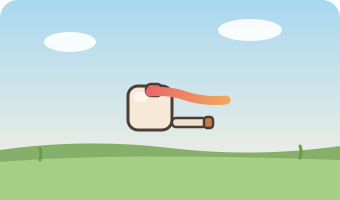

# utilise-field

**A pastel arena game about a rounded cube with a very serious scarf.**

[](https://ardy03851-bit.github.io/utilise-field/)

*One game mode. One island of bots. An infinite number of craters.*

 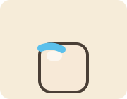

</div>

---

## Overview

**utilise-field** is a small, smooth, pastel 3D arena game that plays like a 2D platformer-shooter.
You are a rounded cube. No eyes, no face — just the cube and a flowing scarf with (very) realistic physics.
Fight waves of bot cubes across procedurally generated biomes, blast craters into the destructible ground,
dig trenches with your shovel, and try to survive as long as you can.

Everything is rendered in real 3D (three.js) but framed from a side angle — a diorama you play inside.
Trees sway leaf by leaf in a global wind field, water reflects the sky, weapons are hand-drawn PNGs
mounted on real 3D quads with recoil and muzzle glow, and the UI is made of actual 3D slabs with thin
dashed outlines that animate in.

- **One game mode — Arena.** Endless waves of bots. No multiplayer, ever.
- **You carry two weapons:** the trusty **Shovel** (dig the ground, trench warfare) and one
  **random weapon** dealt at the start of each round — from a humble Pea Shooter to a Boulder Sling.
- **Fully destructible terrain.** Bullets carve craters, explosions reshape the field, shovels dig.
- **10 biomes**, 13 weapons, wind/weather systems, jelly-squash cubes, spark physics, splashy water.

## Screenshots

| Title | Settings |
|---|---|
| 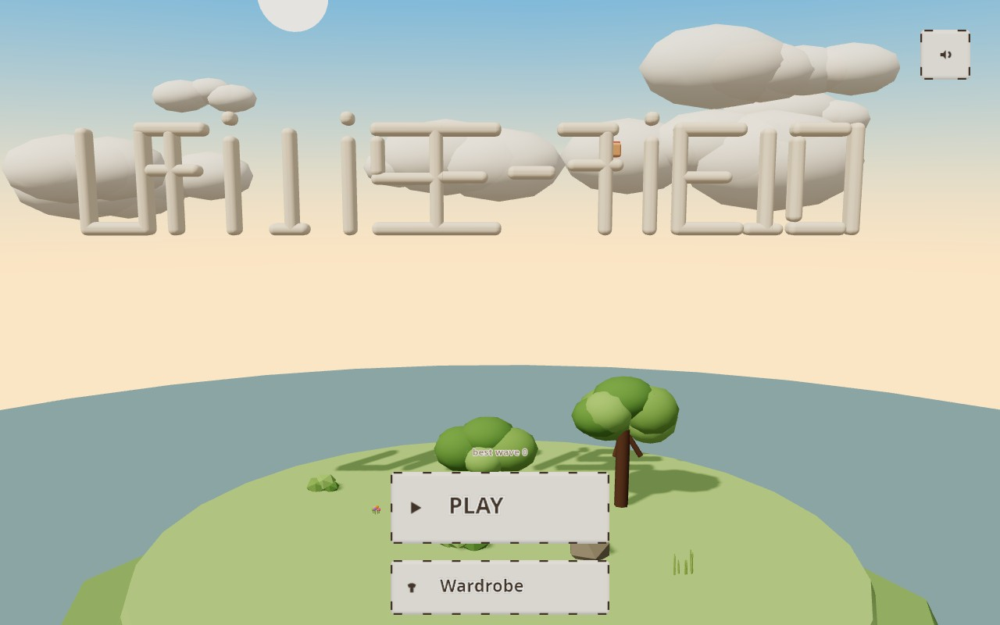 | 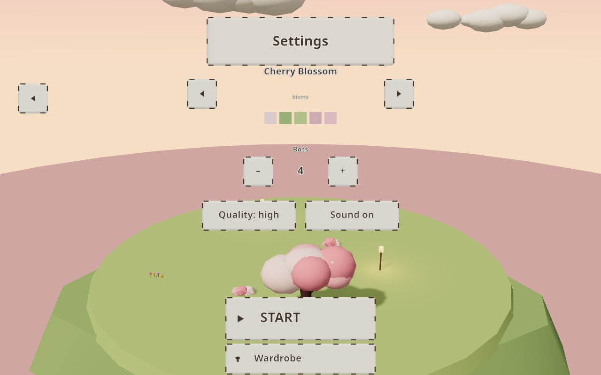 |

| Wardrobe | Arena — Meadow |
|---|---|
| 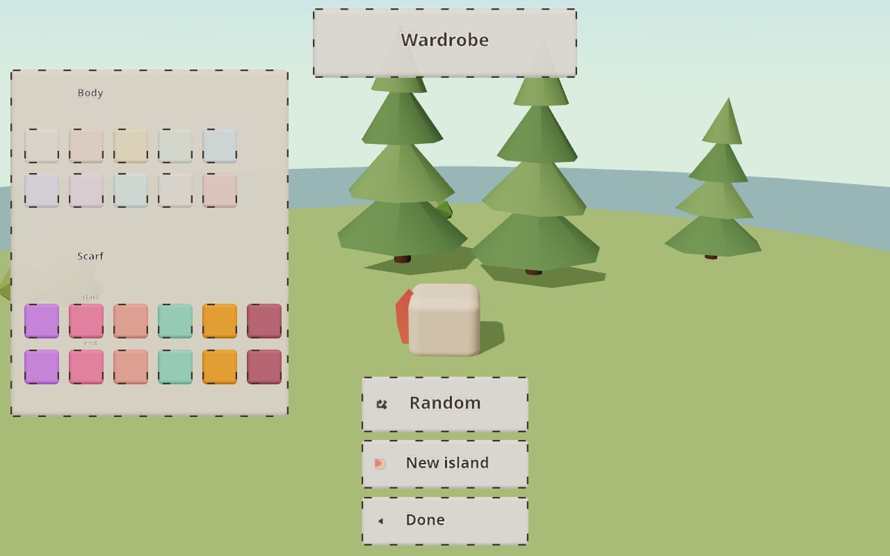 | 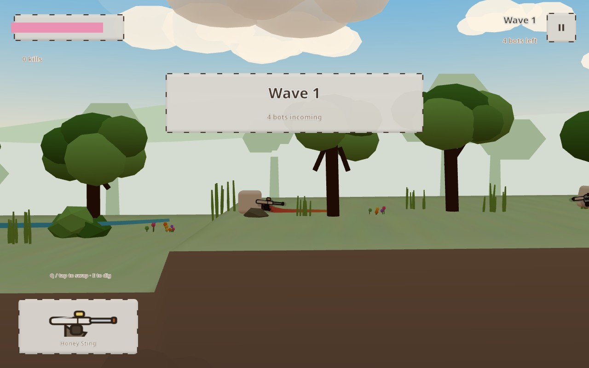 |

| Tropical Islands | Cherry Blossom |
|---|---|
| 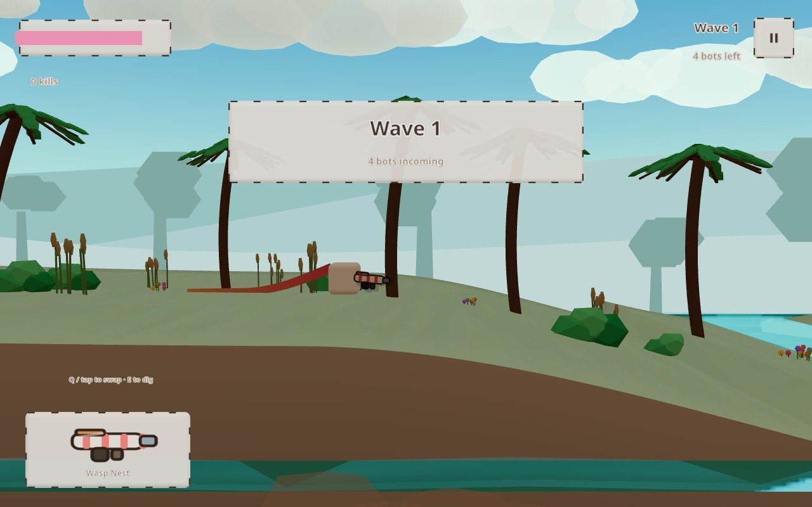 | 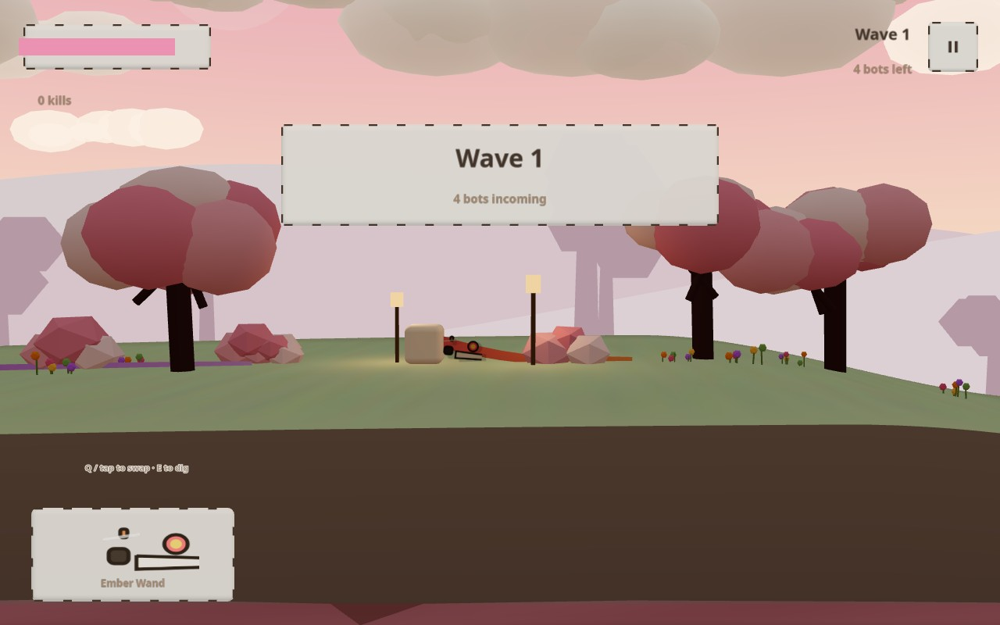 |

| Frost Tundra | Volcanic Ash |
|---|---|
| 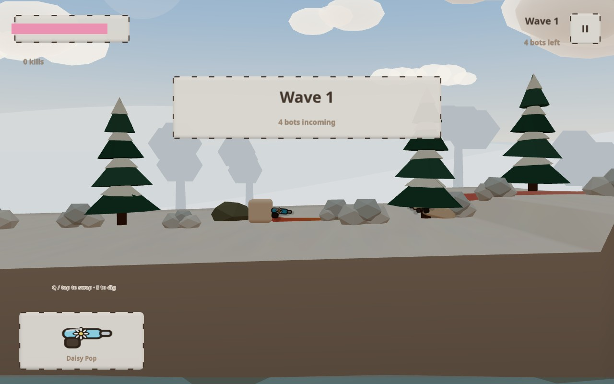 | 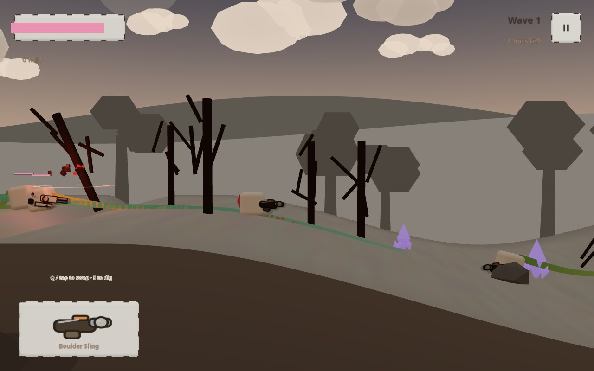 |

## Controls

| Action | Keyboard | Touch / iPad |
|---|---|---|
| Move | `A` / `D` or arrows | left half of screen (virtual stick) |
| Jump | `Space` / `W` | jump button |
| Aim & fire | mouse (hold) | right half of screen (aim stick) |
| Swap weapon | `Q` | tap weapon card |
| Dig (shovel) | `E` (hold) | dig button (hold) |
| Pause | `Esc` / `P` | pause button (top-right) |

## The wardrobe

From the title screen, tap **Wardrobe** and the camera glides over to a tiny randomly generated island
where your cube stands in the wind, scarf blowing — a live preview. Recolour the body, pick scarf
gradient start/end colours, randomise the whole look, or reroll the island itself. Everything is saved
to your browser (localStorage).

## Adding content (no coding required)

The game reads plain folders — you never touch `index.html`.

**Add a weapon:** create `weapons/my-gun/` with two files:

```
weapons/my-gun/manifest.json   →  { "name": "My Gun", "kind": "gun", "dmg": 5, "rate": 1.4,
                                    "speed": 18, "spread": 0.1, "pellets": 1, "range": 10,
                                    "color": "#ffd98a", "order": 70 }
weapons/my-gun/weapon.png      →  256×128 PNG, drawn however you like
```

then run `node tools/make-manifest.js` — done. The weapon now appears in the random deal and the HUD card.

**Add a biome:** create `biomes/my-biome/my-biome.js`:

```js
Biome({
  order: 110, name: "My Biome", weather: "petals", wind: 0.4, pond: true,
  skyT: "#a8d8f0", skyB: "#fdf3e3", sun: "#fffaf2",
  far: ["#cfe3c8", "#b8d4ae", "#a5c79a"],
  top: "#86b06a", mid: "#6b5443", deep: "#3d332c", cap: "#a5cf85",
  props: [["oak", 1], ["bush", 0.5], ["rock", 0.2]],
  bgTrees: "oak", cloud: "#ffffff", water: "#7fa9c0",
  leaf: ["#7fae5a", "#93c46e", "#6a9c4a"], flat: 0.6,
});
```

Run `node tools/make-manifest.js` again. New biome, selectable in settings.

**Available weather kinds:** `rain`, `snow`, `snowfall`, `storm`, `petals`, `fireflies`, `leaves`, `dust`, `ash`.

**Available prop kinds:** `oak`, `autumn`, `cherry`, `birch`, `willow`, `acacia`, `baobab`, `pine`, `snowpine`,
`palm`, `dead`, `bamboo`, `giantshroom`, `cactus`, `bush`, `fern`, `reeds`, `lavender`, `flowers`, `tallgrass`,
`mushroom`, `pumpkin`, `rock`, `gravestone`, `pillar`, `crystal`, `barrel`, `crate`.

## Weapon gallery

Every weapon is drawn by code (`tools/gen-art.js`) — no AI, no stock art:

| | | |
|---|---|---|
| 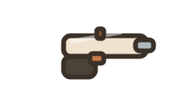 | 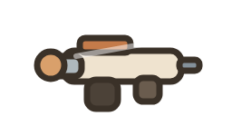 | 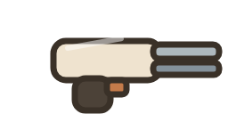 |
| Pea Shooter | Cork Blaster | Boomstick |
|  | 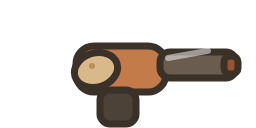 | 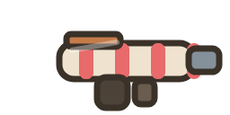 |
| Thunder Mug | Spud Cannon | Wasp Nest |
| 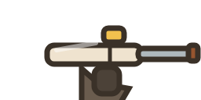 | 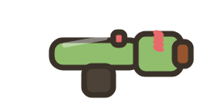 | 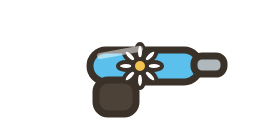 |
| Honey Sting | Lily Launcher | Daisy Pop |
| 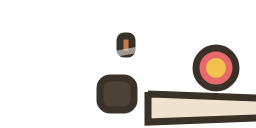 | 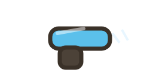 | 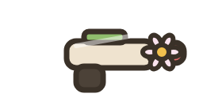 |
| Ember Wand | Frost Bell | Petal Cannon |
| 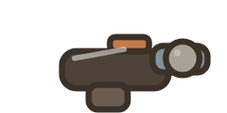 | | |
| Boulder Sling | | |

## Biomes

Meadow · Cherry Blossom · Pine Forest · Desert Oasis · Lavender Fields · Tropical Islands ·
Bamboo Valley · Autumn Woods · Volcanic Ash · Frost Tundra

Each biome changes the sky, terrain palette, water colour, prop set, background tree silhouettes,
wind strength, and weather — and the wardrobe island is generated from one of them at random.

## Running locally

It's a static site — no build step. Clone, then either open `index.html` through any static server
(some browsers block module imports from `file://`), e.g.:

```bash
npx serve .          # or: python3 -m http.server
```

Dev tools live in `tools/` (Node.js, run `npm install` there first):

| Tool | What it does |
|---|---|
| `node tools/gen-art.js` | (re)draws every weapon PNG with code |
| `node tools/make-manifest.js` | rebuilds `weapons/manifest.json` + `biomes/manifest.json` |
| `node tools/smoke.js <name> <url> <waitMs> <clicksJson> [eval]` | headless browser test — serves the game, clicks, screenshots, console errors |

---

# Technical reference

Everything below documents the JavaScript API, module by module. All source lives in `js/`.

## js/core.js — math, colour & registries

| Function | Signature | Description |
|---|---|---|
| `clamp` | `(v, a, b) → number` | Clamps `v` into `[a, b]`. |
| `lerp` | `(a, b, t) → number` | Linear interpolation. |
| `smooth` | `(t) → number` | Smoothstep easing (0→1). |
| `easeOutBack` | `(t) → number` | Overshooting ease for pop-in animations. |
| `easeInOutCubic` | `(t) → number` | Cubic ease in-out. |
| `makeRNG` | `(seed = 1337) → rng()` | Seeded RNG. The returned function also has `rng.range(min, max)` and `rng.pick(arr)`. |
| `makeNoise1D` | `(seed = 7) → noise(x)` | Smooth 1D value noise for terrain and wobble. |
| `hex2rgb` | `(h) → [r, g, b]` | `'#a8d8f0'` → `[168, 216, 240]`. |
| `rgb2hex` | `([r, g, b]) → string` | Array back to hex string. |
| `mix` | `(a, b, t) → string` | Mix two hex colours (0…1). |
| `lit` | `(hex, k) → string` | Add white light (`k` ≈ -0.3…0.3). |
| `shade` | `(hex, k) → string` | Multiply colour by `k`. |
| `jitterHex` | `(hex, rng, k = .06) → string` | Randomly nudge a colour — used for terrain strata variation. |
| `cssGradient` | `(stops, vertical = true) → string` | Build a CSS gradient string from an array of hex stops. |
| `damp` | `(cur, target, lambda, dt) → number` | Framerate-independent exponential smoothing — the workhorse of every animation in the game. |
| `randSign` | `(rng) → ±1` | Random sign. |
| `fmtTime` | `(s) → 'm:ss'` | Format seconds. |
| `BIOMES` | array | All loaded biome definitions (filled by `registry.js`). |
| `WEAPONS` | array | All loaded weapon definitions (filled by `registry.js`). |
| `biomeById` | `(id) → biome` | Look up a biome by folder name. |
| `weaponById` | `(id) → weapon` | Look up a weapon by folder name. |

## js/world.js — destructible terrain, water & sky

`HALF = 90` (map half-length), `STEP = 0.5` (heightfield column spacing), `COLS`, `DEPTH = 26`, `WATER_Y = 0`.

| Function | Signature | Description |
|---|---|---|
| `World` | `new World(scene, biome, seed?)` | Builds the whole arena environment: heightfield terrain, water, sky, background layers. |
| `World.h` | `(x) → number` | Surface height at world `x` — the single source of truth for ground collision. |
| `World.slope` | `(x) → number` | Ground slope at `x` (used for sliding down steep hills). |
| `World.waterAt` | `(x, y) → bool` | True when standing in a pond (slows you, splashes). |
| `World.inWater` | `(x, y) → bool` | True when submerged (bullets splash and die). |
| `World.crater` | `(x, radius, depth)` | **Carve a smooth crater** into the heightfield — bullets and explosions call this. Depth fades from centre to edge; the terrain mesh updates on the fly. |
| `World.raise` | `(x, radius, amount)` | Softly raise ground (dirt piles, repair). |
| `World.ripple` | `(x, strength = 1)` | Splash ripple at water line. |
| `World.refreshTerrain` | `()` | Re-upload merged terrain geometry after deformation. |
| `World.update` | `(dt, t, quality)` | Animates water, sky, clouds, background layers. |
| `World.dispose` | `()` | Free GPU resources. |

## js/character.js — the cube & scarf

| Function | Signature | Description |
|---|---|---|
| `Character` | `new Character(world, opts)` | `opts: { x, body, scarf: [startColour, endColour], hp }`. Extends `THREE.Group` — it *is* the model. |
| `setBodyColor` | `(hex)` | Recolour the cube (wardrobe uses this). |
| `setScarfGradient` | `(stops)` | `[start, end]` colours — the scarf ribbon lerps along its length. |
| `scarfAnchor` | `(out) → Vector3` | World position where the scarf attaches (neck). |
| `jump` | `(power = 13)` | Buffered jump with squash-and-stretch. |
| `hurt` | `(dmg, kx = 0)` | Damage + knockback + brief invulnerability; auto-dies at 0 hp. |
| `die` | `()` | Marks dead; death animation follows. |
| `update` | `(dt, input, t)` | Physics (gravity, ground snap, jelly squash), locomotion, scarf simulation. |
| `updateScarf` | `(dt, t)` | Verlet-style scarf: gravity, wind force, segment constraints, ribbon mesh rebuild in local space. |

## js/wind.js — the global wind field

| Function | Signature | Description |
|---|---|---|
| `Wind.set` | `(biome)` | Set base strength (from `biome.wind`) and randomise direction. |
| `Wind.update` | `(dt)` | Evolves gusts — a slowly wandering noise field. |
| `Wind.at` | `(x, y, out) → {x, y}` | Sample wind at a world point (used by scarf, leaves, bullets, rain). |
| `Wind.sway` | `(x, y) → number` | Sway intensity for prop animation. |

## js/props.js — procedural 3D props

| Function | Signature | Description |
|---|---|---|
| `PROP_DEFS` | object | Weighted prop menus per biome, e.g. `[['oak', 1], ['rock', 0.2]]`. |
| `buildProp` | `(kind, rng, theme) → Group` | Build one prop by kind (oak, palm, pine, crystal, …). Leaves are **separate meshes** so they can resize/rotate/move individually. |
| `animateProp` | `(p, t, camX)` | Per-frame prop animation — leaves flutter (scale, rotation, offset), trees bend with wind, flowers bob. |
| `populateWorld` | `(world, theme)` | Scatter props over the arena heightfield with collision circles. |

## js/weapons.js — weapon rendering & firing

| Function | Signature | Description |
|---|---|---|
| `SHOVEL_FALLBACK` | const | Shovel definition (3D geometry, not a PNG). |
| `loadTex` | `async (url) → Texture` | Cached texture loader with sRGB setup. |
| `WeaponRig` | `new WeaponRig(character)` | Mounts on the character; owns recoil, muzzle flash, walk bob, swing. |
| `WeaponRig.equip` | `async (def)` | Equip a weapon definition — builds the shovel mesh or the PNG quad with drop shadow + rim glow. |
| `WeaponRig.fire` | `() → { bullets: [...] }` | Spawns bullet specs (dmg, speed, spread, pellets, blast radius) with recoil kick + muzzle flash. |
| `WeaponRig.update` | `(dt)` | Animates bob, recoil recovery, flash glow decay. |
| `randomGun` | `(rng) → def` | Pick a random non-shovel weapon (used at round start). |

## js/bullets.js — projectiles & spike trails

| Function | Signature | Description |
|---|---|---|
| `BulletSystem` | `new BulletSystem(world, scene)` | One shared dynamic ribbon geometry for all bullets. |
| `BulletSystem.spawn` | `(spec)` | `spec: { x, y, vx, vy, dmg, color, id, radius, owner }`. |
| `BulletSystem.update` | `async (dt, hitTerrain, hitProp, hitChar, splash)` | Advances bullets (gravity + wind), records the **velocity-scaled spike trail** (capped at 7 world units), then calls your callbacks for terrain/prop/character/water hits. |

## js/vfx.js — particles & effects

| Function | Signature | Description |
|---|---|---|
| `VFX` | `new VFX(scene, world)` | GPU-instanced particle pool. |
| `VFX.emit` | `(opts)` | Raw particle: `{ x, y, vx, vy, life, size, color, gravity, bounce }`. |
| `VFX.debrisBurst` | `(x, y, n, cols, power = 1)` | Dirt/debris chunks that bounce on the terrain. |
| `VFX.ring` | `(x, y, color, grow = 9, dur = .55, vertical = true)` | Expanding shockwave ring. |
| `VFX.flash` | `(x, y, color, power = 9, dur = .22)` | Light flash. |
| `VFX.shake` | `(a)` | Camera shake amount. |
| `VFX.explosion` | `(x, y, color)` | Full combo: flash + ring + debris + shake. |
| `VFX.muzzle` | `(x, y, dir, color)` | Muzzle sparks (with terrain collisions). |
| `VFX.dirt` | `(x, y, dir, n = 12, power = 1)` | Shovel dirt spray. |
| `VFX.sparks` | `(x, y, dir, color, n = 8)` | Impact sparks that bounce off the ground. |
| `VFX.splash` | `(x, y, n = 14)` | Water splash droplets. |
| `VFX.leafBurst` | `(x, y, cols)` | Leaves burst when a tree is hit. |
| `VFX.confetti` | `(x, y)` | Wave-clear celebration. |
| `VFX.update` | `(dt)` | Advance all particles (gravity, wind, terrain bounce). |

## js/bots.js — the enemies

| Function | Signature | Description |
|---|---|---|
| `Bot` | `new Bot(world, x, difficulty = 1)` | A `Character` with an AI brain: random scarf colour, hp bar, weapon. |
| `updateBot` | `(bot, player, dt, ctx)` | AI state machine — approach, keep range, jump gaps, aim with lead, fire. `ctx: { spawnBullet, vfx, audio }`. |
| `botDeath` | `(bot, vfx)` | Death VFX + scarf flies off. |

## js/arena.js — the game mode

| Function | Signature | Description |
|---|---|---|
| `Arena` | `new Arena(renderer, scene, camera, biome, opts)` | `opts: { botCount, quality }`. Owns world, player, bots, bullets, vfx, weather, HUD. Sets `window.__uf` (debug handle). |
| `Arena.update` | `(dt, input)` | The whole game loop: input, physics, bullets, waves, weather, camera. |
| `Arena.togglePause` | `()` | Pause/resume (also `Esc`). |
| `Arena.switchWeapon` | `()` | Swap between shovel and random weapon (`Q`). |
| `Arena.queueWave` | `()` | Queue the next wave of bots. |
| `Arena.spawnBot` | `()` | Spawn one bot at the map edge. |
| `Arena.bulletHitTerrain` | `(b, h)` | Crater + dirt burst on ground impact. |
| `Arena.bulletHitProp` | `(b) → bool` | Damage trees/props (they shake, drop leaves, break). |
| `Arena.bulletHitChar` | `(b) → bool` | Damage bots/player. |
| `Arena.blastDamage` | `(x, y, radius, dmg, owner)` | Radial explosion damage + terrain carve. |
| `Arena.doShovel` | `()` | Dig: carve terrain, dirt spray. |
| `Arena.weather` | `(dt)` | Ambient weather particles (rain/snow/petals/fireflies/…). |
| `Arena.renderCam` | `(dt)` | Side-view camera follow with soft damping. |
| `Arena.dispose` | `()` | Tear down everything. |

## js/ui.js — the 3D UI kit

| Function | Signature | Description |
|---|---|---|
| `UI3D` | `new UI3D()` | Orthographic overlay scene rendered on top of the world. Widgets are real 3D slabs. |
| `UI3D.button` | `(opts) → wd` | `opts: { x, y, w, h, label, icon, color, z, id, emit, onTap, onHold }`. Rectangular hit-testing, appear animation, press squash. |
| `UI3D.panel` | `(opts) → wd` | Cream slab with thin dashed outline. |
| `UI3D.text` | `(str, opts) → wd` | `opts: { x, y, size, color, z, stroke }`. Canvas texture on a quad, soft outline for readability. |
| `UI3D.image` | `(url, opts) → wd` | Texture quad (weapon card art). |
| `UI3D.on` / `emit` | `(evt, fn)` / `(evt)` | Tiny event bus for buttons. |
| `UI3D.clear` | `()` | Remove all widgets. |
| `UI3D.update` | `(dt)` | Drive appear/hover/press animations. |
| `UI` (extends `UI3D`) | `new UI(game, camera, renderer)` | The in-game HUD: health bar, wave banner, kill counter, weapon card, touch buttons. |
| `UI.banner` | `(title, sub)` | Wave banner pop-in. |
| `UI.showPause` | `(show)` | Pause panel (Resume / Restart / Main menu). |
| `UI.gameOver` | `(kills, wave)` | Game-over panel (Play again / Main menu). |
| `iconTexture` | `(kind, opts)` | Icon atlas entry: `play, close, back, left, right, sound, mute, cube, shirt, random, swap…`. |
| `textTexture` | `(str, opts)` | Text → canvas texture (shared with the 3D title). |

## js/menu.js — title & settings

| Function | Signature | Description |
|---|---|---|
| `Menu` | `new Menu(renderer)` | Title scene: floating 3D letters over a random biome diorama. Accepts `?biome=<id>` in the URL. |
| `Menu.startFly` | `()` | The camera flies forward *through the gap in the letter d* into the settings diorama. |
| `Menu.cycleBiome` | `(dir)` | Settings biome picker. |
| `Menu.collectSettings` | `() → { biome, botCount, quality }` | Passed to the arena on START. |

## js/wardrobe.js — customisation island

| Function | Signature | Description |
|---|---|---|
| `Wardrobe` | `new Wardrobe(renderer)` | Random island (tree, bushes, clear view of your cube), camera fly-in, swatch UI. |
| `Wardrobe.setBody` | `(col)` | Body colour → save + live preview. |
| `Wardrobe.setScarfStop` | `(stop, col)` | Scarf gradient stop (0 = start, 1 = end). |
| `Wardrobe.randomise` | `()` | Random body + scarf combo. |
| `Wardrobe.regenerate` | `()` | New random island. |

## js/diorama.js — menus' little worlds

| Function | Signature | Description |
|---|---|---|
| `makeSky` | `(scene, biome, rng) → { update(dt, t, camX) }` | Gradient dome, sun, drifting clouds. |
| `makeIsland` | `(scene, biome, rng, opts) → Group` | `opts: { propCount, propRadius, avoid: {x, z, r}, water }`. Floating pastel island with terrain top, dirt cone underside, water disc, props. |
| `makeTitle` | `(text, color, outline) → { group }` | Real 3D rounded-tube letters — the game logo is geometry, not a texture. |

## js/input.js — keyboard, mouse & touch

| Function | Signature | Description |
|---|---|---|
| `Input.init` | `(el)` | Bind pointer/keyboard/touch. |
| `Input.update` | `(dt, camera, renderer)` | Per-frame: virtual sticks, mouse world position, buffered jump. |
| `Input.buttons` | array | 3D buttons register here — rectangular hit-testing happens before gameplay. |
| `Input.pressBtn` | `(id)` | Programmatically press a HUD button. |
| `Input.mouse` | `{ x, y, down }` | Mouse state in screen pixels. |
| `Input.sticks` | `{ move, aim }` | Touch pointer ids / stick state. |

## js/audio.js — sound (no assets, all synth)

| Function | Description |
|---|---|
| `Audio.init()` | Lazy-create the WebAudio context (needs a user gesture). |
| `Audio.click/shoot/dig/thud/boom/hit/hurt/jump/splash/win/gameover(def)` | Synthesised SFX per event. |
| `Audio.setMuted(m)` | Mute toggle (settings button). |

## js/saves.js — persistence

| Function | Description |
|---|---|
| `SAVES.look()` / `setLook(look)` | Character colours + scarf (wardrobe). |
| `SAVES.settings()` / `setSettings(s)` | Bots, quality, sound. |
| `SAVES.stats()` | `bestWave`, total kills. |
| `SAVES.recordRun(wave, kills)` | Update bests after a run. |

## js/registry.js — content loader

| Function | Description |
|---|---|
| `Content.load()` | Fetches `weapons/manifest.json` + `biomes/manifest.json`, then each folder's `manifest.json` / `.js`, and fills `BIOMES` / `WEAPONS` in `core.js`. This is how new folders become game content without touching `index.html`. |

## js/main.js — boot & flow

| Function | Description |
|---|---|
| `loop(now)` | Render loop + mode switch (menu / wardrobe / game) + performance guard (drops pixel ratio below 40 fps). |
| `startGame(biome, opts)` | Build the `Arena`. |
| `applyQuality(q)` | Shadow/pixel-ratio presets (`low` / `high`). |
| events | `uf-start`, `uf-wardrobe`, `uf-menu`, `uf-restart` — window events that drive scene transitions. |

---

## Tech notes

- **three.js r160**, zero other runtime dependencies; static hosting (GitHub Pages).
- Terrain is a single merged `BufferGeometry` (361-column heightfield + strata + skirt) rebuilt on destruction — one draw call.
- Bullets share one ribbon geometry with per-bullet draw ranges; particles are one `InstancedMesh` pool.
- The scarf is a local-space verlet chain (11 nodes) solved every frame against gravity, wind and velocity, rendered as a camera-facing ribbon with per-segment gradient.
- Weapon PNGs sit on 3D quads with a shadow quad, emissive rim that flashes on fire, and recoil translation.
- Everything UI is 3D: slabs with thin dashed outlines that are deliberately "cut" and resume — no DOM, no CSS.

<div align="center">


*made with a cube, a scarf, and an unreasonable amount of wind physics*
</div>
